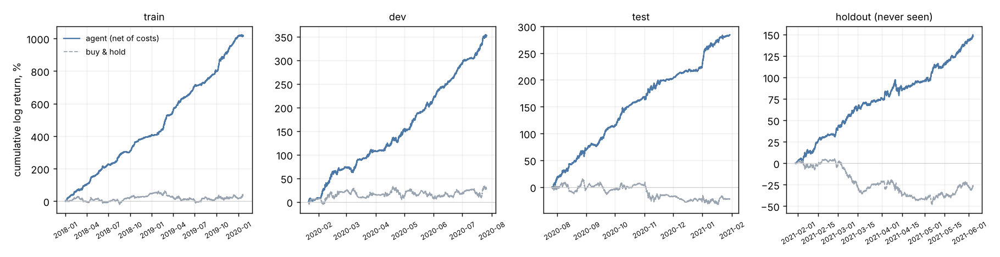

# drl-fx-agent

A deep reinforcement learning agent for currency trading, built end to end: raw data → cleaning →
cost model with carry → features → environment → actor-critic agent (PPO) → walk-forward tests →
go-live checklist. Around it are the checks that decide whether the agent has anything to trade:
predictability tests of the inputs, rule-based benchmarks on six currency pairs, and an agent that
only sizes a known rule.

## What I found

No edge after costs. On EUR/USD, agents that choose long, short or flat looked profitable in single
runs, but different random starts disagreed and the walk-forward profits came from the benchmark,
not from timing; with a reward against being flat and carry included, the agents learned the carry
trade and nothing more. Simple models confirm why: past prices, the euro-dollar rate gap, two news
indices and the German-US 2-year yield gap do not predict the next day's move, linear or nonlinear.

On six pairs, carry earned a Sharpe of about 0.2 to 0.3 before financing, trend and mean reversion
less. Picking or weighting rules by their recent results did no better than chance. An agent that
only sizes the carry basket did worse than a fixed size and worse than simple volatility or VIX
rules. After a retail broker's financing markup on borrowed currency, nothing earns money. Section 5
has the numbers.

Earlier tests on US equity ETFs (agents that ended up simply holding the ETF) are in the archived
repository [DRL-trading-agent](https://github.com/anhvotn/DRL-trading-agent).


*Pipeline check on a synthetic market with a planted edge. Solid: agent net of costs; dashed: buy & hold. Validates the pipeline, not a strategy.*

## Quick start

```
git clone https://github.com/anhvotn/drl-fx-agent.git
cd drl-fx-agent
pip install -r requirements.txt

pytest -q                                              # 32 tests, about a minute
jupyter notebook notebooks/walkthrough.ipynb           # guided run on synthetic data, ~1-2 min
python -m drl_fx.run --demo                        # full demo on synthetic data, ~5 min on CPU

python -m drl_fx.run --csv data/eurusd_15m_carry.csv --fee-bp 0.2                    # EUR/USD
python -m experiments.seed_robustness --csv data/eurusd_15m_carry.csv --fee-bp 0.2       # 9 agents: do they agree? (~40 min)
python -m experiments.walk_forward --csv data/eurusd_15m_carry.csv --fee-bp 0.2 --seed 0 # retrain every 6 months (~25 min)
python -m experiments.predictability --prices data/eurusd_duka_15m.csv --rate-base data/ECBDFR.csv \
    --rate-quote data/DFF.csv --epu data/USEPUINDXD.csv --sffed data/news_sentiment_data.xlsx   # do the inputs predict anything? (~10 s)
python -m experiments.nonlinear_and_volatility --daily data/eurusd_daily.csv          # nonlinear models and volatility (~5 min)
python -m experiments.power_check --daily data/eurusd_daily.csv                      # how strong a nonlinear pattern must be to be found (~1 min)
python -m experiments.multi_pair_rules                                               # 18 rules on six pairs (~5 min)
python -m experiments.yield_gap                                                      # 2-year yield gap on EUR/USD (~10 s)
python -m experiments.sizing_agent --seeds 0,1,2                                     # agent sizes the carry basket (~15 min)
```

`--fee-bp 0.2` adds Interactive Brokers' FX commission (0.2 basis points of the amount traded).
The reward is what the position earns, against being flat; `--vs-buy-and-hold` measures it against
holding long instead.
Several pairs can be trained together by passing several files: `--csv data/eurusd_15m.csv,data/usdjpy_15m.csv`.

## Getting the data

From Interactive Brokers, with TWS running (paper login is fine, API enabled under
File > Global Configuration > API > Settings):

```
python ib_test.py                                      # checks the connection with a few EUR/USD bars
python download_ib_history.py                          # EUR/USD 15-min, 8 years, with bid/ask -> data/eurusd_15m.csv
python download_ib_history.py --symbol USDJPY          # other pairs
```

Longer history without TWS, from Dukascopy's free feed:

```
python download_dukascopy.py                           # EUR/USD 15-min -> data/eurusd_duka_15m.csv
python download_dukascopy.py --start 2007-01-01 --end 2012-01-01 --out data/eurusd_duka_2007_2011.csv
python download_dukascopy.py --pair GBP-USD --start 2012-01-01 --hourly   # hourly bars -> data/gbpusd_duka_1h.csv
```

Hourly bars are enough for the daily tests and download about four times faster than 15-minute bars.

Both downloaders save as they go and continue where they stopped when run again. Dukascopy sometimes
skips months; check the years in the file before training (the current download has 2012–2026
complete but is missing 2008–2011). Downloaded data stays out of git (see `.gitignore`).

Interest rates for carry, from FRED (click "Max", then Download → CSV, save to `data/`):
[ECBDFR](https://fred.stlouisfed.org/series/ECBDFR) (ECB deposit facility rate) and
[DFF](https://fred.stlouisfed.org/series/DFF) (US federal funds effective rate).
For other currencies, the BIS publishes daily policy rates for more than 40 central banks in one file:
[data.bis.org/bulkdownload](https://data.bis.org/bulkdownload) → Central bank policy rates → CSV.
For the yield and risk tests: [DGS2](https://fred.stlouisfed.org/series/DGS2) (US 2-year yield),
the Bundesbank's [daily two-year Federal Treasury note yield](https://www.bundesbank.de/en/statistics/money-and-capital-markets/interest-rates-and-yields/daily-yields-of-current-federal-securities-772220)
(series BBSSY.D.REN.EUR.A610.000000WT0202.A) and [VIXCLS](https://fred.stlouisfed.org/series/VIXCLS).

News indices, downloaded in a browser and saved to `data/`: the
[SF Fed Daily News Sentiment Index](https://www.frbsf.org/research-and-insights/data-and-indicators/daily-news-sentiment-index/)
(US newspaper sentiment since 1980) and, optionally, the
[Economic Policy Uncertainty index](https://fred.stlouisfed.org/series/USEPUINDXD) (choose "Max" before downloading).
Add them to a price file, delayed to when they were published:

```
python add_daily_features.py --prices data/eurusd_15m.csv --sffed data/news_sentiment_data.xlsx \
    --rate-base data/ECBDFR.csv --rate-quote data/DFF.csv --out data/eurusd_15m_carry.csv
```

This adds `sentiment_sffed` (usable 7 days after the date, as the index is updated weekly) and
`rate_base` / `rate_quote` (usable from the next day). Add `--epu data/USEPUINDXD.csv` for the
uncertainty index (7-day average, usable from 09:30 New York time the next day).

## Repository layout

```
drl_fx/
  data.py        loading, cleaning, cost model, features, splits, regime labels
  env.py         Gymnasium trading environment (buy / sell / hold, PnL and Sharpe rewards)
  agent.py       GRU encoders per data type + PPO actor-critic, two-stage training, fine-tuning
  evaluate.py    fast backtest, metrics, regime breakdown, go-live checklist, ensemble weights
  run.py         command-line pipeline
  synthetic.py   regime-switching synthetic market for testing
experiments/
  seed_robustness.py   trains agents with different windows and random starts, compares them
  walk_forward.py      retrains on an expanding window and trades the following months
  predictability.py    daily bars: do the inputs predict the next day at all? (linear and logistic models)
  nonlinear_and_volatility.py  gradient boosting and a two-encoder net for direction; volatility forecasts and sizing
  power_check.py       how strong a planted nonlinear pattern must be before the models find it
  multi_pair_rules.py  carry, trend and mean reversion on six pairs; equal vs recent-performance weights
  yield_gap.py         does the German-US 2-year yield gap predict EUR/USD?
  sizing_agent.py      PPO agent that sizes the six-pair carry basket, walk-forward vs hand-made sizing
notebooks/walkthrough.ipynb   one full run with outputs
tests/test_pipeline.py        look-ahead, cost, split and backtest-consistency tests
download_ib_history.py        FX history from Interactive Brokers
download_dukascopy.py         FX history from Dukascopy
add_daily_features.py         adds daily news indices to a price file, with publication delays
ib_test.py                    checks the IBKR connection
assets/                       demo chart and demo outputs
outputs/eurusd_baseline       single EUR/USD run (section 5)
outputs/seed_robustness       nine agents compared (section 5)
outputs/walk_forward          walk-forward with three random starts, reward vs buy & hold, no carry (section 5)
outputs/walk_forward_carry    walk-forward with three random starts, reward vs flat, with carry (section 5)
outputs/predictability        daily predictability test (section 5)
outputs/nonlinear_volatility  nonlinear direction test, volatility forecasts and sized carry/trend (section 5)
outputs/multi_pair_rules      18 rules on six pairs and ways of weighting them (section 5)
outputs/yield_gap             2-year yield gap test on EUR/USD (section 5)
outputs/sizing_agent          agent sizing the carry basket, three seeds (section 5)
```

## Tests

The tests target the bugs that make a backtest look better than it is:
features must not change when future data is removed, gaps are filled only from the past,
splits are chronological, normalisation uses training statistics only, the reward uses the
*next* bar's return, costs are charged exactly when the position changes, and the fast
batched backtest matches a step-by-step simulation. Further tests cover the reward measured
against buy-and-hold, the check for agents stuck in one position (always long, short or flat),
currency data without volume, training on several instruments, the commission setting, carry
(including weekends and data gaps), and the benchmark strategies using only past data.

Two outside code reviews led to six more tests: an episode cut off at its training length is
reported to PPO as truncated rather than finished; `reset(seed=...)` fixes the episode starts,
also when several instruments are trained together; the input groups of the GRU encoders must use
each column exactly once; price gaps are filled for at most 5 bars and slow series (rates, news) for
at most 7 days, so a series that stops updating is not repeated for ever; and `macro_rate_diff` is
never listed twice. Cleaning the four EUR/USD files gives identical results before and after these
changes, as none of them has gaps. Delaying the carry and trend rules by one 15-minute bar leaves
carry unchanged (Sharpe 0.28) and moves trend from 0.08 to −0.01, well inside the noise.

## Data format

CSV columns: `timestamp, open, high, low, close, volume` plus `bid, ask` and any `sentiment*`
columns (forward-filled to the bar frequency **using only information published before the bar**).
Interactive Brokers gives FX as midpoint bars without volume (stored as −1); Dukascopy includes tick
volume. Bars per year (used to annualise Sharpe ratios) is measured from the data, about 25,000 for
15-minute FX bars; override with `--ppy`. Trading costs are half the bid-ask spread, a market-impact
estimate and the commission from `--fee-bp`.

With `rate_base` and `rate_quote` (percent per year), every position also pays or earns carry: the
interest gap between the two currencies for the time it is held until the next bar, so a position held
over a weekend pays about two days. Gaps over five days count as missing data. The agent also gets
the gap itself as an input (`macro_rate_diff`). Any column starting with `sentiment` or `macro_` goes
to the second encoder.

---

## 1. System architecture

```
 market data ─┐                                   ┌─► order (buy / sell / hold)
              ├─► GRU encoder (price/volume) ─┐   │      │
 sentiment  ──┴─► GRU encoder (sentiment)   ──┼─► actor-critic policy (PPO) = "command center"
                                  position ───┘          │
                                                         ▼
                       net PnL (after spread + slippage) ─► reward ─► policy optimisation
```

| Component | Where |
|---|---|
| RL trader / command center that chooses buy, sell or hold | `env.py` (`HOLD, BUY, SELL`) + PPO policy in `agent.py` |
| Deep recurrent network (DRNN) feeding the trader | `SplitGRUExtractor` in `agent.py` |
| Separate networks per data type, not one blended network | one GRU per input group (price vs sentiment) |
| Actor-based methods work best | PPO (actor-critic) |
| Window of data, experiment, reward/punish | `TradingEnv` random-start episodes over a sliding window |
| PnL first, Sharpe in later stages | stage 1 `reward="pnl"`, stage 2 `reward="sharpe"` (differential Sharpe ratio) with lower LR |
| Reward/punish (added detail) | the reward is what the position earns including carry, against being flat; `--vs-buy-and-hold` measures it against holding long, which suits markets that mostly rise |
| Policy optimisation loop with new market data | `fine_tune()`; re-run on rolling windows |

## 2. Development steps → code

1. **Data quantity** – `check_data_size()` warns below 100k rows. 15-minute FX bars give about 25,000
   rows a year, so four years already meet the guideline; daily bars would need decades.
2. **Market & risk choice** – FX < equities < crypto in risk; leverage scales all of it. EUR/USD is the
   most liquid currency pair, which keeps spreads and the impact model honest.
3. **Slippage / market impact** – `estimate_costs()`: half bid-ask spread + square-root impact
   `k·σ·√(trade size / volume)`; it falls back to an estimate from size, volume and volatility when
   there is no bid/ask data. The checklist re-runs the holdout at **2× costs**.
4. **Cleaning** – `clean()`: drop periods with too much missing data, fill short gaps.
   Linear interpolation would use the *next* price, which is look-ahead bias in a backtest, so the
   default is forward-fill (`fill="interpolate"` is still available for plots).
5. **Many algos, weight the recent winners** – `--windows` × `--seeds` trains different agents;
   `ensemble_weights()` gives softmax weights by recent (dev) Sharpe, zero weight to any agent with Sharpe ≤ 0.
6. **Numeric + sentiment data** – one encoder per data type.
7. **Out-of-sample backtesting** – chronological train 60 / dev 15 / test 15 / **holdout 10** (most
   recent, untouched until the end). Normalisation is fitted on train only.
8. **Representative regimes** – `label_regimes()` tags up / down / steady / volatile; metrics are reported per regime.
9. **Survivorship & corporate actions** – not an issue for currency pairs (no delistings, splits or
   dividends). Positions held overnight pay or earn the interest gap (carry, always included); the
   broker's markup on borrowed currency is added in the sizing test.

## 3. Go-live checks → `go_live_checklist()`

| Check | Pass rule |
|---|---|
| Long history, different conditions | no regime with Sharpe < −0.5 out of sample; all four regimes present |
| Works on an untrained instrument at the same timestep | `--transfer-csv` (e.g. another currency pair) Sharpe > 0 |
| Decent train, dev **and** test | `diagnose()` → OK / OVERFIT / UNDERFIT |
| ↳ overfit (good train, bad test) | more data, shallower network, higher `--dropout` |
| ↳ underfit (bad train) | more inputs, deeper network, tune hyper-parameters, check weight init |
| Holdout Sharpe ≥ threshold | default threshold 0.5 |
| Beats the carry and trend strategies (added) | holdout Sharpe above holding the higher-yielding currency and above a 3-month trend rule |
| Beats random trading (added) | holdout Sharpe above the best 5% of 50 random strategies that trade as often as the agent |
| Robust to costs | holdout Sharpe > 0 at 2× costs |
| Not stuck in one position (added) | trades at least 0.002 times per bar and is not ≥ 0.95 correlated with buy & hold; catches agents that are always long, short or flat |

Then: `fine_tune()` on the newest data with a small learning rate → **paper trade** (demo account)
for several weeks and compare live fills to the backtest cost model → go live with **micro size**,
with hard limits outside the agent:
max position, daily loss stop, kill switch.

## 4. Demo results (synthetic market – pipeline validation only)

The synthetic market (`synthetic.py`) is regime-switching with a deliberately planted, persistent
sentiment edge. A naive "trade the sign of sentiment" rule gets Sharpe ≈ 3.7 after costs at 0.32 turnover/bar.

| | train | dev | test | holdout | holdout 2× cost | transfer | B&H holdout |
|---|---|---|---|---|---|---|---|
| Sharpe | 4.78 | 5.37 | 5.00 | **4.44** | 4.33 | 3.98 | −0.83 |

The agent learned to hold positions through noise (turnover 0.03/bar, 10× less than the naive rule),
so it beat the rule after costs. With a near-zero edge, the same pipeline produced Sharpe ≈ −1.3 on holdout and the checklist failed it.
**This is the behaviour wanted: it finds a real edge and rejects noise.** Real markets have far
weaker edges. A holdout Sharpe above ~2 on real intraday data usually means a bug or leakage, not alpha.

## 5. Results on EUR/USD

Data: 15-minute EUR/USD bars with bid/ask from Interactive Brokers, November 2018 to November 2026
(196,814 bars, traded around the clock), with the SF Fed news index added and IBKR's 0.2 bp
commission. Split by date 60/15/15/10: training to September 2023, dev to November 2024, test to
February 2026, holdout after.

*Single run* (`outputs/eurusd_baseline`). The first agent that actually times the market: it switches
between long and short about once a day and is never stuck in one position. Holdout Sharpe 0.56
against −1.56 for buy & hold, 6 of 9 checks passed. It is not consistent, though: Sharpe 0.49 in
training, 0.13 in dev, −0.13 in test, and most of the holdout gain came in its last three weeks. The
checklist flags it as overfit and weak in steady and rising markets.

### Is the result real? Two checks

*Different random starts and window sizes* (`outputs/seed_robustness`). Nine agents, windows of 20,
40 and 80 bars with three random starts each, trained on the same data. Their holdout Sharpe ratios
range from −1.80 to +2.32 (median −0.86, buy & hold −1.56). Only 3 of 9 made money, their positions
correlate at 0.14 on average, and all nine are on the same side in only 3% of bars. A vote of all
nine has a holdout Sharpe of −1.25. Even the agent with the single run's exact settings scored −0.86
this time instead of +0.56; the only difference was the number of CPU threads, which changes the
training slightly. The 0.56 was luck.

*Walk-forward* (`outputs/walk_forward`). Retrain on all data so far, trade the next 6 months, repeat:
8 folds from November 2022 to November 2026, four years the agents never trained on. Repeated with
three random starts:

| | Sharpe | Return | Positive folds | Max drawdown |
|---|---|---|---|---|
| seed 0 | 0.84 | +27.5% | 7 of 8 | −10.7% |
| seed 1 | −0.02 | −0.5% | 4 of 8 | −12.8% |
| seed 2 | 0.49 | +13.3% | 6 of 8 | −8.0% |
| vote of the three | 0.35 | +9.9% | | −13.1% |
| buy & hold | 0.19 | +5.7% | | |

Seed 0 alone looks convincing, and most of its profit comes from changing position within a fold
rather than one directional bet. But the three seeds disagree: their positions correlate at −0.38 to
+0.31, and seed 1 makes nothing. Only May to November 2024 was profitable for all three (when they
were mostly short and EUR/USD fell). Averaged over seeds the agent does somewhat better than holding,
but with four years of data a Sharpe difference of this size is well within what chance produces.

Both checks above measured the reward against buy & hold and ignored carry. For a currency pair, both
choices are questionable: EUR/USD has no long-term drift, so holding it long is an arbitrary
benchmark, and a held position pays or earns the interest gap between euro and dollar every night.

### Reward against flat, with carry (`outputs/walk_forward_carry`)

Same walk-forward, now with the reward measured against being flat, carry charged on every position,
and the rate gap as an extra input. Euro rates were below dollar rates the whole time, so holding
EUR/USD long cost 0.6–2.6% a year, and the carry strategy is "always short EUR/USD".

| | Sharpe | Return | Positive folds | Max drawdown |
|---|---|---|---|---|
| seed 0 | 0.03 | +0.9% | 4 of 8 | −13.8% |
| seed 1 | −0.08 | −2.3% | 4 of 8 | −12.6% |
| seed 2 | 0.15 | +3.9% | 3 of 8 | −10.0% |
| vote of the three | 0.17 | +4.8% | | −13.2% |
| carry strategy | 0.04 | +1.1% | | |
| trend strategy (3 months) | −0.24 | −6.6% | | |
| buy & hold | −0.04 | −1.1% | | |

All three agents mostly learned the carry trade: in most folds they stayed short the whole six months
and hardly traded, and their equity curve sits on top of the carry strategy's. Where they deviated
(seed 1 went long for the last fold), they lost. None beats random trading at its own turnover. The
earlier walk-forward profits came from the buy-and-hold benchmark rewarding short positions while the
euro fell, not from timing.

**Conclusion:** no edge. With a reward that fits FX and realistic carry, the agent's best answer is
the carry trade, which earned almost nothing over 2022–2026. The 15-minute price features, the news
index and the rate gap do not tell it when to deviate. It is not ready for paper trading.

### Do the inputs predict anything? (`outputs/predictability`)

A cheap check before more RL training: if simple models cannot use the inputs, an RL agent given
the same inputs is unlikely to either. `experiments/predictability.py` rolls the Dukascopy 15-minute
bars into daily bars (FX days close at 17:00 New York time), 3,800 days from April 2012 to November
2026, and builds twelve daily inputs, each from information public at that day's close: past returns
over 1, 5, 20 and 60 days, 20-day volatility, distance from the 20-day average, the euro–dollar rate
gap and its 60-day change, the EPU index and its 20-day change, and the SF Fed news index and its
20-day change. Every January a linear model (ridge) and a direction model (logistic) are fitted on
all earlier days and predict every day of that year: 2,826 days from 2016 to 2026.

Neither model predicts the next day. The linear model's out-of-sample R² is −1.9% (worse than
predicting zero), its forecasts correlate with the actual moves at 0.008 and get the direction right
on 49.1% of days. The direction model gets 50.1%. With this many days, correlations within ±0.037
are noise, and no input on its own gets outside that band; the largest is −0.023 for the 20-day return.

Trading the forecasts (long when a rise is expected, short otherwise), net of spread, commission and
carry:

| | Sharpe | Return | Trades a year |
|---|---|---|---|
| linear model | −0.23 | −16.7% | 31 |
| direction model | −0.05 | −3.5% | 46 |
| carry (always short EUR/USD here) | 0.19 | +16.5% | 0 |
| trend (last 60 days) | −0.15 | −11.1% | 19 |
| buy & hold | −0.19 | −14.1% | 0 |

The standard error of these Sharpe ratios is about 0.3, so none differs reliably from zero. Random
trading at the models' pace reaches 0.44 in its best 5%. Both models did well in 2016–2017 and then
lost it, the usual pattern of a pattern that does not last.

To check that the test can find a signal at all, an artificial input correlated with the next day's
move was added. At a correlation of 0.10 the test finds it clearly (0.058 out of sample, strategy
Sharpe 0.39); at 0.05 it gets lost in the noise. So these inputs carry no daily signal of 0.10 or
more; a fainter one cannot be ruled out, but would be worth little after costs.

**Conclusion:** the problem is the inputs, not the agent. Price history, the rate gap and the two
news indices do not predict daily EUR/USD moves, so further RL training on them is unlikely to help.

### Nonlinear models and volatility (`outputs/nonlinear_volatility`)

A common idea is to blend numerical and categorical inputs and give different kinds of input
their own network. `experiments/nonlinear_and_volatility.py` tries this on the same daily data and
the same yearly retraining from 2016 (2,826 out-of-sample days). It asks two questions.

**Direction.** Besides the linear model, a gradient-boosting model and a small neural net with one
encoder for the price inputs and a separate encoder for the rate and news inputs predict the next
day's move.

| | Correlation with next day | Hit rate | Strategy Sharpe |
|---|---|---|---|
| linear | 0.008 | 49.1% | −0.23 |
| gradient boosting | −0.032 | 50.0% | −0.19 |
| two-encoder net | −0.004 | 49.8% | −0.19 |

All correlations sit inside the noise band of ±0.037, and random trading at the same pace reaches
about 0.45 in its best 5%. The nonlinear models find no direction signal either.

This test is weaker than the linear one. An interaction was planted (the sign of the 20-day change
in policy uncertainty times the sign of the 5-day return) and the models had to recover it.
`experiments/power_check.py` shows how strong it must be:

| Planted correlation | Boosting, all 12 inputs | Boosting, only the 2 relevant inputs |
|---|---|---|
| 0.14 | 0.037 | 0.087 |
| 0.22 | 0.070 | 0.159 |
| 0.31 | 0.129 | 0.261 |

With all inputs, boosting picks up only about a third of a planted pattern, and the two-encoder net
found nothing even at 0.22. So a nonlinear signal of around 0.15 or weaker could have been missed.
A signal that weak would barely pay for the spread anyway.

**Volatility.** Volatility is far easier to forecast than direction, so the second question is
whether the news and rate inputs help predict the size of the next five days' moves. The target is
the log of next-week realised volatility.

| | R² out of sample | Gain over last month's volatility |
|---|---|---|
| last month's volatility (naive) | 4.8% | 0 |
| price only (HAR: 1-, 5- and 20-day volatility) | 16.2% | +11.9% |
| price + news + rates | 9.6% | +5.1% |
| gradient boosting, all inputs | 1.6% | −3.4% |

Adding news and rates makes the forecast worse than price history alone (Newey-West t = −2.89;
boosting t = −5.51).

Scaling carry and trend to a 6% annual volatility target with these forecasts:

| | Fixed size | Naive vol | Price-only forecast | Price + news + rates |
|---|---|---|---|---|
| carry Sharpe | 0.19 | 0.27 | 0.25 | 0.19 |
| trend Sharpe | −0.15 | −0.26 | −0.24 | −0.21 |

Volatility sizing lifts carry a little and hurts trend, within the standard error of about 0.3.

**Conclusion:** neither a nonlinear model nor separate networks for the news inputs turn them into a
signal, for direction or for volatility. For sizing positions, a forecast from past prices is enough.

### Many rules on six pairs, weighted by recent results (`outputs/multi_pair_rules`)

A common idea is to run many algorithms that behave differently in different markets and trade
the ones that did best in the last few months, or give them more weight.
`experiments/multi_pair_rules.py` tests this with three rules on six pairs (EUR/USD, GBP/USD,
AUD/USD, USD/JPY, USD/CHF, USD/CAD; Dukascopy prices, BIS policy rates, ECB deposit rate for the
euro), 18 strategies in all:

- carry: hold the currency with the higher policy rate;
- trend: long if the pair rose over the past three months, short if it fell;
- mean reversion: short when the price is more than one standard deviation above its 20-day
  average, long when it is that far below.

Each is sized to 6% annual volatility from the past 60 days, net of half the spread, commission and
carry. Weights are set at each month end from past data only. Scored from 2013 to November 2026
(14.3 years; Sharpe standard error about 0.26).

| | Sharpe | Return a year | Max drawdown |
|---|---|---|---|
| carry, 6 pairs | 0.19 | 0.7% | −10.4% |
| trend, 6 pairs | 0.08 | 0.3% | −9.6% |
| mean reversion, 6 pairs | −0.03 | −0.1% | −6.8% |
| carry, off when VIX is in its top 20% of the past year | 0.30 | 0.9% | −6.9% |
| all 18, equal weights | 0.17 | 0.3% | −4.5% |
| weighted by Sharpe of last 3 months | 0.10 | 0.3% | −12.9% |
| weighted by last 6 months | −0.08 | −0.3% | −14.8% |
| weighted by last 12 months | 0.09 | 0.3% | −10.7% |
| best 3 of the last 3 months | 0.07 | 0.3% | −18.7% |

Handing the same weights to strategies at random gives a median Sharpe of 0.12 for the 3-month
weighting (95th percentile 0.40) and 0.09 for the best-3 rule (0.45). Weighting by recent results
does no better than chance, and worse than equal weights. The reason shows in the ranks: across
166 months, how well a strategy did over the past 1, 3, 6 or 12 months says nothing about the
next month (rank correlations −0.05, −0.03, 0.00, 0.00; none significant).

Switching carry off when VIX is high raised its Sharpe from 0.19 to 0.30 and cut the drawdown by a
third. It was the one filter decided before the run, but the gain is still within the noise.
All of these returns are before the broker's financing markup on borrowed currency. At IBKR a small
account borrows at the benchmark rate plus 1.5% a year, and is paid less than the benchmark on
cash, which costs more than any of these strategies earns.

**Conclusion:** the rules earn little, and choosing among them by recent results does not help in
FX over 2013–2026. Equal weights across many pairs and rules give the smoothest result.

### 2-year yield gap (`outputs/yield_gap`)

Two-year government yields price where each central bank is expected to take rates, so they move
before the policy rates do. `experiments/yield_gap.py` tests three inputs on EUR/USD, fixed before
the run: the German minus US 2-year yield (Bundesbank, FRED DGS2), its 20-day change, and its gap
to the policy rate gap (the expected change in policy). Each is used from the day after its date.
2,826 out-of-sample days, 2016 to November 2026.

The data is right: on the same day, a widening gap and a rising euro go together (correlation
0.26). But none of the three predicts the next day's move (correlations 0.007, 0.003, 0.017,
noise band ±0.037), and a ridge model retrained each year finds nothing either (−0.012).

Of the two rules, following the 20-day change in the gap earned a Sharpe of 0.40, in 8 of 11 years.
That equals the 95th percentile of random trading at the same pace, and it is fragile: the same
rule over 10, 40 or 60 days gives −0.06, 0.17 and 0.03. It is not a disguised trend rule (the
20-day EUR/USD trend earned −0.06). Following the expected policy change earned 0.12.

**Conclusion:** the yield gap explains how EUR/USD moves on the day but does not forecast it.
The 20-day rule is worth re-testing on other pairs, with their own 2-year yields, before anyone
trades it.

### The agent sizes a rule instead of choosing direction (`outputs/sizing_agent`)

Here the agent no longer decides long or short. Carry on the six pairs picks the direction, and
each day the agent sets one scale between 0 (out) and 2 (double) for the whole basket.
`experiments/sizing_agent.py` gives it the basket's recent returns, volatility and drawdown, VIX
and the size of the rate gaps, all known at the close. It is trained with PPO on the differential
Sharpe ratio, retrained every year on all earlier years, three seeds, 2016 to November 2026
(Sharpe standard error about 0.30).

| | Sharpe | Return a year | Max drawdown | After 1.5% financing |
|---|---|---|---|---|
| carry at fixed size | 0.34 | 1.3% | −6.5% | 0.03 |
| volatility targeting | 0.32 | 1.1% | −7.7% | −0.02 |
| off when VIX is in its top 20% | 0.38 | 1.3% | −5.7% | 0.08 |
| agent, seed 0 | 0.17 | 0.8% | −10.0% | −0.07 |
| agent, seed 1 | 0.15 | 0.8% | −7.6% | −0.08 |
| agent, seed 2 | 0.24 | 1.2% | −8.3% | −0.01 |

The agent fails every check set before the run: it does worse than holding the rule at a fixed
size, worse than both hand-made sizing rules, and below its own scales reshuffled at random
(95th percentile 0.27 to 0.36). It changes its scale about 145 times a year and swings between 0
and 2 without timing the bad periods, which adds volatility and no return. Even the simple
sizing rules move the Sharpe by only a few hundredths, so there is little for any sizing method
to gain on this basket. After IBKR's financing markup, nothing earns money.

**Conclusion:** the condition for this setup was that the agent must beat its rule, or the rule is
traded instead. It does not, and the rule itself does not pay after financing on a retail account.

## 6. Suggested next steps

1. Futures instead of spot FX. The interest gap is priced into a futures contract, so the retail
   financing markup disappears, and a trend portfolio across equity, bond, commodity and currency
   futures has much stronger published evidence than any single-market rule tested here.
2. A paper-trading loop on the Interactive Brokers paper account (prices → signal → order → fills →
   comparison with the backtest), with position and loss limits outside the strategy. Useful as
   engineering even without an edge, and needed before any live trading.
3. Re-test the 20-day yield gap rule on the other five pairs with their own 2-year yields; on
   EUR/USD alone it is indistinguishable from luck.

*Research code, not investment advice.*
